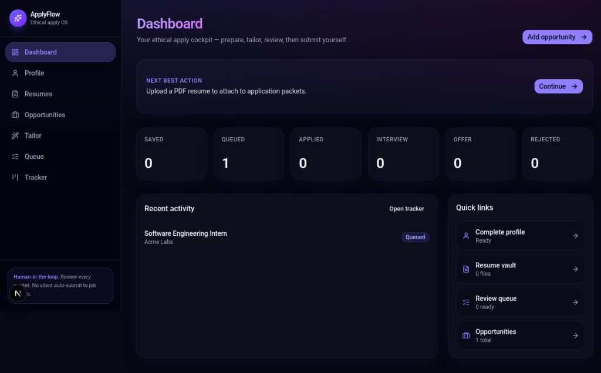

<h1 align="center">ApplyFlow</h1>

<p align="center">
  A command center for your job search. Find open roles, prepare each application, and track it to an outcome.<br />
  ApplyFlow never submits for you. You open the apply link, send the application yourself, and then mark it Applied.
</p>

<p align="center">
  <a href="#running-it">Run it locally</a>
  ·
  <a href="#configuration">Keys and configuration</a>
</p>

<p align="center">
  
</p>

ApplyFlow works through openings one packet at a time. It pulls live roles from Remotive, Arbeitnow, and any company's public Greenhouse or Lever board. You pick the roles you want, and ApplyFlow builds a packet for each one: a cover letter, highlights and five common answers, written from the profile you enter. You review the batch, open each apply URL yourself, and mark the application Applied once you have sent it.

It is a Next.js 15 app that runs on your machine, with SQLite through better-sqlite3 and Drizzle ORM. Your data stays in a local `data/` folder. There is no account and no billing. The only keys are optional, and they unlock two more job sources.

## What you get

- **Live roles from public sources only.** Remotive and Arbeitnow need no key. Greenhouse and Lever read a company's public board from its slug or URL. There is no LinkedIn or Indeed integration. Results are cached in SQLite for 20 minutes, and each source accepts one search every 1.5 seconds.
- **No duplicate saves.** Imports compare URLs after removing the hash, the UTM tags and `gh_src`, then lowercasing the result. Roles you already saved are skipped on import and flagged in Discover.
- **Packets built from your profile.** The tailor matches your skills against the job title, company, description and your notes. It writes a cover letter, up to five highlights and five common answers. Skill matches come only from your profile and the posting. An empty profile field shows as a bracketed prompt, such as `[Add salary floor to profile]`.
- **A checklist before every Mark Applied.** Each packet starts with six steps, from re-reading the posting to confirming the resume and opening the apply URL. Mark Applied asks you to confirm, and it warns you when steps are still open.
- **Labeled resumes.** Upload PDF versions, give each one a label, and set a default. New packets use the default unless you choose another. Only PDF files are accepted.
- **A tracker and a dashboard.** Each opportunity moves through saved, queued, applied, interview, offer, rejected and ghosted. The tracker changes status in bulk. The dashboard shows the funnel, the last eight weeks of applications, and a response rate: interviews, offers and rejections divided by applied.
- **Export everything.** Settings exports JSON with every table, or a CSV of opportunities, and the JSON restores through the same page. Resume PDFs are not in the export, so keep a copy of those files.
- **Keyboard first.** Press `g` and then a letter to jump between pages, such as `g` then `q` for the queue. Ctrl+K or Cmd+K opens the command palette.

## Running it

Use Node.js 20 or newer.

```sh
npm install
npm run dev
```

Open [http://localhost:3000](http://localhost:3000). A first-run checklist walks you through your profile, a resume, your first opportunity and your first packet.

For a production build:

```sh
npm run build
npm start
```

`npm test` runs the two Node test files in `tests/`.

## Configuration

Nothing is required. Discover works with no keys at all. To add the two optional sources, copy the example file and fill in the values you need. Restart `npm run dev` after you edit `.env`.

```sh
cp .env.example .env
```

| Variable | Purpose |
| --- | --- |
| `USAJOBS_API_KEY` | Turns on the USAJobs source. Get a free key at developer.usajobs.gov. |
| `USAJOBS_USER_AGENT` | Email address sent with each USAJobs request. Needed with the key. |
| `ADZUNA_APP_ID` | Turns on Adzuna. Needs `ADZUNA_APP_KEY` too. Free developer account. |
| `ADZUNA_APP_KEY` | Adzuna key, paired with `ADZUNA_APP_ID`. |
| `ADZUNA_COUNTRY` | Adzuna country code. Defaults to `us`. |

## Your data

- The first run creates `data/applyflow.db`, a SQLite database in WAL mode, and `data/resumes/` for uploaded PDFs. The `data/` folder is in `.gitignore`.
- Each user table carries `workspace_id` and `user_id`, both set to `local`. The schema is ready for more accounts, but only one workspace exists today.
- Outbound requests go to the job APIs and company boards you use. They also go to any link you paste into the opportunity form, which is fetched for its title and Open Graph tags.
